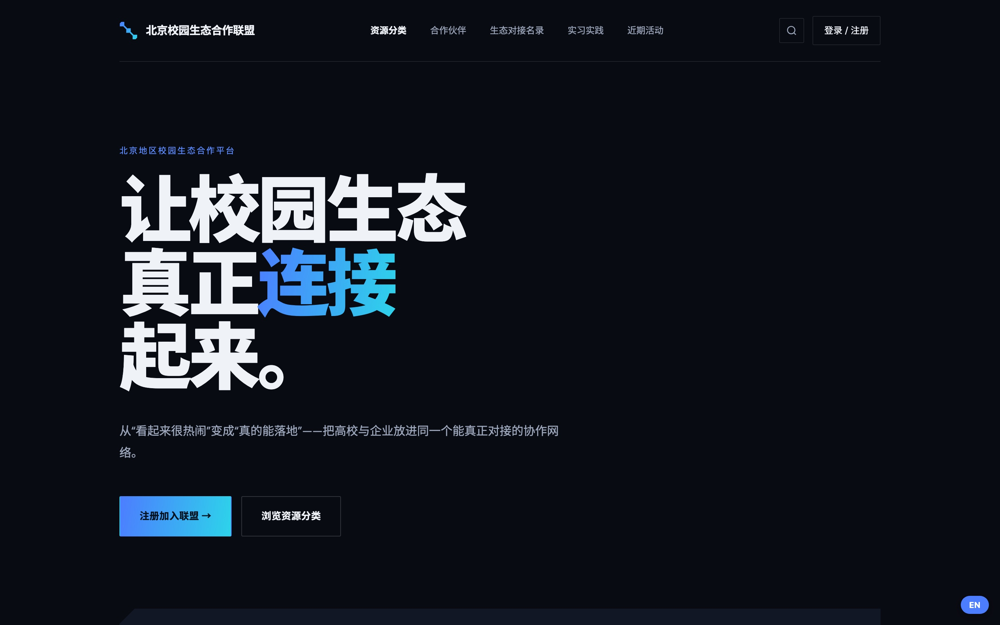
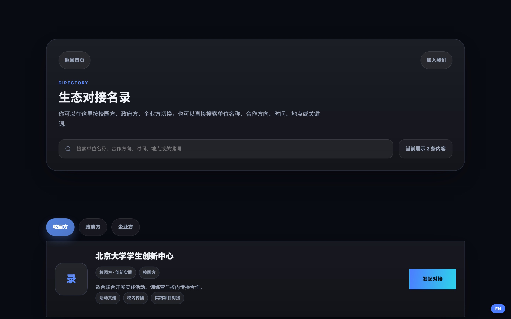
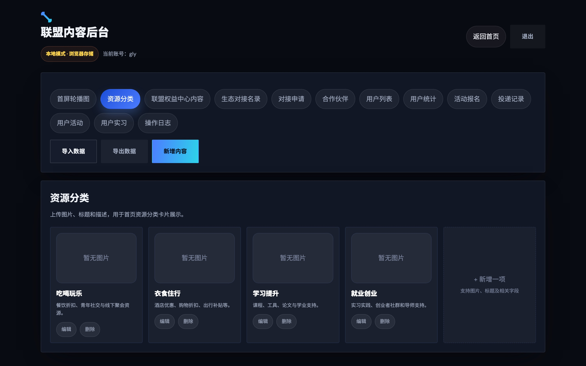

<div align="center">
  
  <p><b>北京校园生态合作联盟</b> — a platform connecting universities and companies, so that internships, events and collaboration requests actually get matched instead of sitting in a WeChat group.</p>
  <p>
    <a href="https://github.com/Voskamp099/campus-ecosystem-network/actions/workflows/ci.yml"></a>
    <a href="https://beijing-alliance.onrender.com"></a>
    
    
    
    
    
  </p>
  <p>
    <a href="README.md">English</a> · <a href="README.zh-CN.md">简体中文</a>
  </p>
</div>

---

## Capabilities at a glance

<div align="center">

<table>
  <thead>
    <tr>
      <th align="center" width="60">&nbsp;</th>
      <th align="center" width="210">Capability</th>
      <th align="left">What it actually does</th>
    </tr>
  </thead>
  <tbody>
    <tr>
      <td align="center">🏫</td>
      <td align="center"><b>Ecosystem directory</b></td>
      <td align="left">University, government and company partners in one list — filterable by type and searchable by keyword.</td>
    </tr>
    <tr>
      <td align="center">🔄</td>
      <td align="center"><b>Five-stage applications</b></td>
      <td align="left">Every application gets a tracking code and moves through <code>pending → reviewing → matched → contacted → completed</code>.</td>
    </tr>
    <tr>
      <td align="center">📝</td>
      <td align="center"><b>User posts &amp; moderation</b></td>
      <td align="left">Registered users publish events and internships; admins approve or reject, with a reason attached to the rejection.</td>
    </tr>
    <tr>
      <td align="center">🔐</td>
      <td align="center"><b>Layered security</b></td>
      <td align="left">JWT sessions, double-submit CSRF cookies, schema validation, rate limiting and sanitised request bodies.</td>
    </tr>
    <tr>
      <td align="center">🛟</td>
      <td align="center"><b>Degrades instead of failing</b></td>
      <td align="left">When MySQL is unreachable the data layer falls back to a JSON file store — the site stays up instead of crashing.</td>
    </tr>
    <tr>
      <td align="center">🗂️</td>
      <td align="center"><b>12-tab admin console</b></td>
      <td align="left">Full CRUD, drag-and-drop ordering, moderation, user and statistics views — plus a complete operation audit log.</td>
    </tr>
    <tr>
      <td align="center">🚀</td>
      <td align="center"><b>Three ways to run it</b></td>
      <td align="left">As a Node service, as a static site with no backend, or by double-clicking <code>public/index.html</code> in local mode.</td>
    </tr>
  </tbody>
</table>

</div>

> **About this repository** — published as a portfolio artefact so the engineering can be
> reviewed. It is not an open-source release and carries no licence; see [NOTICE](NOTICE).
> Sample data has been redacted and the commit history is preserved as written.

---

## Screenshots

<p align="center">
  
  <br /><br />
  
  
</p>

<p align="center"><em>Top: the homepage — hero carousel, partner matrix and the benefits hub.
Bottom left: the ecosystem directory with type filters and keyword search.
Bottom right: the admin console.</em></p>

---

## What it does

| Module | What it does |
| --- | --- |
| 首页 Home | Hero carousel, partner matrix, benefits hub, featured jobs and events |
| 联盟权益中心 Benefits hub | Benefits grouped by life scenario, each with its own detail list |
| 生态对接名录 Directory | University and company partners, filterable and searchable |
| 对接申请 Applications | Users file an application against a listed partner; the system issues a tracking code and drives it through a five-stage workflow |
| 用户发布 User posts | Registered users publish events and internships; admins approve or reject with a reason |
| 个人中心 Personal centre | Applications, event registrations and job submissions in one place |
| 后台管理 Admin | Full CRUD and ordering for every content section, plus moderation, user list, statistics and an audit log |

The interface is Chinese by default and switches to English with the EN button; the module
names above are the real names used in the UI.

---

## Engineering highlights

### 🛟 Degrades instead of failing

The whole data layer sits behind one interface: `isDatabaseAvailable()`. If MySQL is
unreachable, reads fall back to a JSON file store and writes report `503` rather than
crashing the process. The service still boots, still serves the site, and the admin
console still works.

This is not theoretical. The application was built and tested with MySQL down for most
of its life, and the fallback path is what made local development possible at all.

### 🔐 Security model

Every write goes through a fixed chain, and each link is a deliberate choice:

| Layer | Mechanism |
| --- | --- |
| Session | JWT in `Authorization: Bearer`, verified per request by `verifyToken` |
| CSRF | Double-submit cookie — the token is issued by `GET /api/csrf-token`, stored in a cookie, and must be echoed in `x-csrf-token`; mismatch is `403` |
| Identity | Records are scoped to the `userId` inside the token, never to a phone number in the query string |
| Input | `express-validator` schemas plus an `xss` filter on request bodies |
| Transport | `helmet` security headers, `cors` with an allowlist, `csrf-csrf` |
| Abuse | Per-route rate limiters, global API limiter, `trust proxy` so `req.ip` is correct behind Nginx |
| Passwords | bcrypt with cost 12; hashes are never logged |
| Observability | Pino structured logs, Sentry error tracking, `/health` `/ready` `/live` probes |

### 🐛 One bug worth calling out

Four legacy routes under `/api/user/*` took a phone number from the query string and
returned that person's directory applications, activity registrations and delivery
records. No authentication was required. Anyone who guessed a phone number could pull
another person's records — including their name, organisation and contact details.

They now require a JWT and resolve the identity from the token, matching the
`/api/user-center/*` routes sitting next to them.
`__tests__/integration/user-records-auth.test.js` pins the behaviour down, including
the case where a valid token is combined with someone else's phone number in the query.

### 🧪 Testing

114 tests across 14 suites, driving the real Express app through `supertest` — no mocks
of the framework itself.

```
Test Suites: 14 passed, 14 total
Tests:       114 passed, 114 total
```

Coverage is 93% on `utils/csrf.js`, 93% on `utils/validator.js` and 87% on
`server/auth.js`.

Test names are written as the guarantee they protect, so a failure tells you what broke
rather than which line broke. For example: `写操作不带 CSRF token 时被拒绝` — "a write
without a CSRF token is rejected".

---

## Architecture

```
                    ┌──────────────────────────────┐
  Browser  ───────▶ │  Express app                 │
                    │  helmet · cors · csrf · rate  │
                    │  limiter · sentry · pino      │
                    └───────────────┬──────────────┘
                                    │
              ┌─────────────────────┼─────────────────────┐
              ▼                     ▼                     ▼
      /api/auth  /api/admin   /api/user   /api/public   service layer
      JWT + bcrypt           admin console               │
                                                            ▼
                                              ┌─────────────────────────┐
                                              │  isDatabaseAvailable()  │
                                              └───────┬─────────┬───────┘
                                          MySQL OK    │         │  MySQL down
                                          ┌───────────▼──┐   ┌──▼──────────────┐
                                          │  MySQL 8     │   │  JSON file store│
                                          │  InnoDB      │   │  (fallback)    │
                                          └──────────────┘   └─────────────────┘
```

Content is modelled as `section_key` + `group_key` + ordered items, which is why one
admin table can drive the hero carousel, the benefits hub, the directory and the
events list without any of them knowing about the others.

---

## Tech stack

<div align="center">
<p>
  
  
  
  
  
  
  
  
</p>
<p>
  
  
  
  
  
  
  
  
  
</p>
</div>

No framework, no build step — the front end is plain HTML, CSS and ES6+.

**Backend** Node.js 18+, Express 4, MySQL 8 (InnoDB, utf8mb4), `mysql2`, `jsonwebtoken`,
`bcryptjs`, `csrf-csrf`, `helmet`, `express-rate-limit`, `express-validator`, `xss`,
`pino`, `@sentry/node`, `swagger-jsdoc`, `nodemailer`, `sharp`, `@volcengine/tos-sdk`

**Frontend** Vanilla HTML / CSS / ES6+. No framework, no build step required to run it.
The admin console is a single-page app with drag-and-drop ordering; it also runs
entirely in `file://` mode against `localStorage` so it can be demoed with no server.

**Testing** Jest + supertest

---

## Project layout

```
server/
  index.js              Express app; exports the app so tests can drive it without a port
  routes/               auth, admin, user-center, user-submissions, public
  services/             business logic, one module per bounded area
  utils/                csrf, cors, rate-limiter, validator, sentry, logger, errors
  scripts/              MySQL init and migration
  docs/                 OpenAPI specs
public/
  index.html            homepage
  admin.html            content console
  assets/               styles, scripts, polish layer
  assets/dist/          minified builds for production
database/
  schema.sql            full schema
  migrations/           incremental migrations
docs/
  ARCHITECTURE.md       detailed design
  DEPLOYMENT.md         deployment guide
  screenshots/
__tests__/
  unit/                 service-level tests
  integration/          supertest suites against the real app
```

---

## Getting started

```bash
npm install
cp .env.example .env      # fill in JWT_SECRET and ADMIN_PASSWORD at minimum
node server/index.js
```

The site is on `http://localhost:3000`, the console on `http://localhost:3000/admin`.

You can also skip the server entirely — open `public/index.html` directly in a browser
and it runs in local mode with `localStorage` as the backing store.

## Deploying

**Live site:** [https://beijing-alliance.onrender.com](https://beijing-alliance.onrender.com)

The site runs on Render as a Node web service. `render.yaml` is a Render
Blueprint: point Render at this repository (**New → Blueprint**) and it wires up
the build, the health check and the environment variables. The service name in
that file fixes the address:

```
https://beijing-alliance.onrender.com
```

Variables marked `syncFrom: false` in `render.yaml` have to be filled in on the
Render dashboard — most importantly `ADMIN_PASSWORD` and `SITE_URL`. The server
refuses to start without `JWT_SECRET` and `CSRF_SECRET`; Render generates both
from the blueprint. If MySQL is not configured the service degrades to JSON
files under `data/`, which is fine for a demo and not for real traffic.

### The static demo site

The same `public/` directory can also be published with no backend at all, via
GitHub Pages. This workflow is manual-only, because the repository does not have
Pages enabled — turn it on under **Settings → Pages → Source → GitHub Actions**,
then trigger the workflow by hand.

```
https://voskamp099.github.io/campus-ecosystem-network/
```

On that host the frontend probes for a backend (`public/assets/runtime-mode.js`);
finding none, it switches to local mode on its own. The probe distinguishes
"there is no backend" (a 404) from "the probe failed" (a timeout or a 5xx) — the
latter is treated as "the backend is there", so a slow cold start never demotes
a live deployment into demo mode.

Two demo accounts are available in that mode. The password is fixed and printed
on the login page, because a static demo has no server-side credential to
protect:

| Account | Password | Lands on |
| --- | --- | --- |
| `gly` | `demo2026` | the admin console |
| `test@alliance.local` | `demo2026` | the user centre |

Both use the reserved `.local` domain and only work where no backend is
reachable, so they cannot be used against a real deployment.

```bash
npm test                  # 114 tests
npm run test:coverage     # coverage report
```

The API is documented with Swagger at `/api-docs` while the server is running.

---

## Notes

- The partner names and example listings shipped as seed content are **demo data**
  (`server/defaults.js`), not formal partnerships.
- Personal data that ended up in the sample dataset has been redacted, and the same
  redaction was applied across the full commit history.
- `CSRF_SECRET` in `.env.example` is still a placeholder. Replace it before deploying —
  in production the server refuses to start without it.

## License

Not open source. See [NOTICE](NOTICE) — no permission is granted to copy, modify or
redistribute this code.
