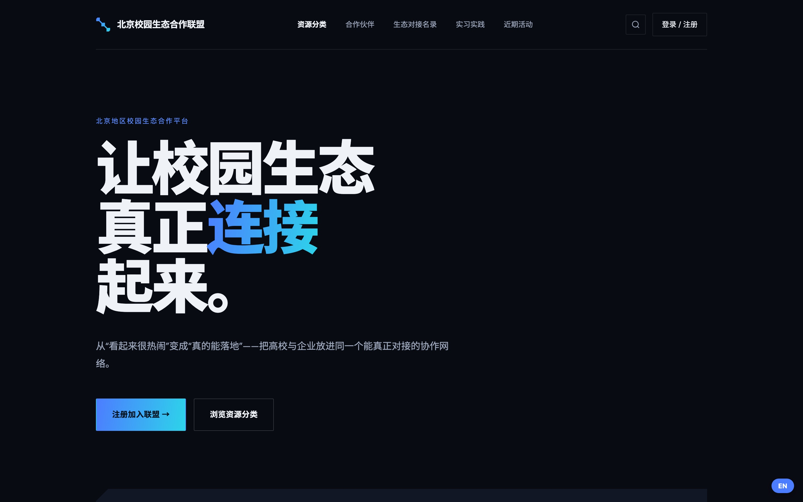
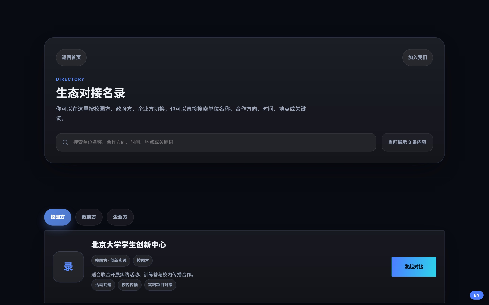
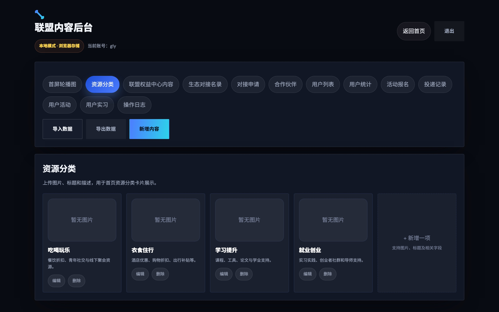

# 北京校园生态合作联盟（Campus Ecosystem Network）

连接高校与企业的全栈平台，让实习机会、活动与合作需求真正被匹配起来，
而不是躺在一个微信群里。

[English](README.md) · [简体中文](README.zh-CN.md)

[](https://github.com/Voskamp099/campus-ecosystem-network/actions/workflows/ci.yml)

> **关于本仓库** — 作为作品展示公开，用于说明平台背后的工程实现。本仓库不以开源项目方式发布，
> 未授予任何许可，详见 [NOTICE](NOTICE)。样本数据已脱敏，提交历史保留原样。



<p align="center">
  
  
</p>

---

## 平台能力

| 模块 | 说明 |
| --- | --- |
| 首页 | 首屏轮播、合作伙伴展示、联盟权益中心、实习岗位与近期活动推荐 |
| 联盟权益中心 | 按吃喝玩乐、衣食住行、学习提升、就业创业等生活场景分类浏览，每类有独立的详情列表 |
| 生态对接名录 | 高校与企业伙伴名录，支持按类型筛选与关键词搜索 |
| 对接申请 | 用户针对名录中的合作方发起申请，系统自动生成追踪码，并按五段流程推进状态 |
| 用户发布 | 注册用户可发布活动和实习实践信息，管理员审核通过或拒绝并可附原因 |
| 个人中心 | 对接申请、活动报名、实习投递记录集中查看 |
| 后台管理 | 各内容栏目的增删改查与拖拽排序，以及投稿审核、用户列表、统计概览和操作日志 |

## 工程亮点

### 降级而不是崩溃

整个数据层只暴露一个接口：isDatabaseAvailable()。MySQL 连不上时，读操作降级到 JSON 文件存储，
写操作返回 503，而不是让进程崩掉。服务照常启动、照常对外提供页面，后台控制台也照常可用。

这不是理论上的设计。这个应用在大部分生命周期里都是在 MySQL 停着的状态下开发和测试的，
正是这条降级路径让本地开发成为可能。

### 安全模型

每一次写操作都走同一条固定的链条，每一环都是刻意选的：

| 层次 | 机制 |
| --- | --- |
| 会话 | JWT 放在 Authorization: Bearer 里，由 verifyToken 逐请求校验 |
| CSRF | 双重提交 Cookie——token 由 GET /api/csrf-token 下发、写进 Cookie，请求时必须在 x-csrf-token 里回传同一个值，不一致直接 403 |
| 身份 | 记录一律按令牌里的 userId 限定范围，绝不接受 query 里传入的手机号 |
| 输入 | express-validator 校验 schema，配合 xss 对请求体做过滤 |
| 传输层 | helmet 安全头、带白名单的 cors、csrf-csrf |
| 防滥用 | 分路由限流器、全局 API 限流，trust proxy 保证 Nginx 后面 req.ip 取值正确 |
| 密码 | bcrypt cost 12，哈希值不进日志 |
| 可观测 | Pino 结构化日志、Sentry 错误追踪、/health /ready /live 三个探针端点 |

### 一个值得单独说的 bug

/api/user/ 下的四条历史遗留路由，从 query 里取手机号，直接返回这个人的对接申请、
活动报名和投递记录，全程不需要任何认证。谁猜到一个手机号，就能拉走别人的记录——
包括姓名、单位和联系方式。

现在这四条路由必须带 JWT，并从令牌里解析身份，和紧挨着它们的 /api/user-center/*
保持一致。__tests__/integration/user-records-auth.test.js 把这个行为钉住了，
其中包括"带着合法令牌、但 query 里填别人的手机号"这一种情况。

### 测试

8 个套件共 64 个测试，用 supertest 驱动真正的 Express 应用，不对框架本身做 mock。

```
Test Suites: 8 passed, 8 total
Tests:       64 passed, 64 total
```

utils/csrf.js 覆盖率 91%，utils/validator.js 93%，server/auth.js 87%。

测试用例名写的是它守护的那条保证，所以失败时告诉你的是"哪条保证被破坏了"，
而不是"第几行坏了"。例如：写操作不带 CSRF token 时被拒绝。

## 架构

```
                    ┌──────────────────────────────┐
  Browser  ───────▶ │  Express app                 │
                    │  helmet · cors · csrf · rate  │
                    │  limiter · sentry · pino      │
                    └───────────────┬──────────────┘
                                    │
              ┌─────────────────────┼─────────────────────┐
              ▼                     ▼                     ▼
      /api/auth  /api/admin   /api/user   /api/public   服务层
      JWT + bcrypt           后台控制台                   │
                                                            ▼
                                              ┌─────────────────────────┐
                                              │  isDatabaseAvailable()  │
                                              └───────┬─────────┬───────┘
                                          MySQL 可用  │         │  MySQL 不可用
                                          ┌───────────▼──┐   ┌──▼──────────────┐
                                          │  MySQL 8     │   │  JSON 文件存储  │
                                          │  InnoDB      │   │  （降级）      │
                                          └──────────────┘   └─────────────────┘
```

内容用 section_key + group_key + 有序条目来建模，所以同一张后台表格能同时驱动首屏轮播、
联盟权益中心、生态对接名录和近期活动列表，而这几块彼此并不需要知道对方存在。

## 技术栈

**后端** Node.js 18+、Express 4、MySQL 8（InnoDB，utf8mb4）、mysql2、jsonwebtoken、
bcryptjs、csrf-csrf、helmet、express-rate-limit、express-validator、xss、
pino、@sentry/node、swagger-jsdoc、nodemailer、sharp、@volcengine/tos-sdk

**前端** 原生 HTML / CSS / ES6+，不依赖框架，也不需要构建步骤就能跑起来。后台控制台是
带拖拽排序的单页应用，同时支持 file:// 模式用 localStorage 完整运行，不起服务也能演示。

**测试** Jest + supertest

## 目录结构

```
server/
  index.js              Express 应用；导出 app 让测试无需占用端口即可驱动
  routes/               auth、admin、user-center、user-submissions、public
  services/             业务逻辑，按限界上下文一个模块
  utils/                csrf、cors、rate-limiter、validator、sentry、logger、errors
  scripts/              MySQL 初始化与迁移
  docs/                 OpenAPI 文档
public/
  index.html            前台首页
  admin.html            内容后台
  assets/               样式、脚本、视觉打磨层
  assets/dist/          生产用压缩构建
database/
  schema.sql            完整表结构
  migrations/           增量迁移
docs/
  ARCHITECTURE.md       详细设计
  DEPLOYMENT.md         部署指南
  screenshots/
__tests__/
  unit/                 服务层测试
  integration/          针对真实应用的 supertest 套件
```

## 本地运行

```bash
npm install
cp .env.example .env      # 至少要填 JWT_SECRET 和 ADMIN_PASSWORD
node server/index.js
```

站点在 http://localhost:3000，后台在 http://localhost:3000/admin。

也可以完全不起服务——直接在浏览器里打开 public/index.html，它会以本地模式运行，
底层存储换成 localStorage。

## 部署

站点以 Node Web Service 的形态跑在 Render 上。`render.yaml` 是 Render Blueprint：
在 Render 控制台 **New → Blueprint** 指向本仓库，构建命令、健康检查和环境变量
都会自动配好。该文件里的服务名决定了访问地址：

```
https://campus-ecosystem-network.onrender.com
```

`render.yaml` 里标了 `syncFrom: false` 的变量需要在 Render Dashboard 上手动填，
其中最关键的是 `ADMIN_PASSWORD` 和 `SITE_URL`（填错会让密码重置邮件里的链接
指向 localhost）。服务缺 `JWT_SECRET` 或 `CSRF_SECRET` 会拒绝启动，这两个由
Blueprint 自动生成。不配置 MySQL 时服务会自动降级到 `data/` 下的 JSON 文件，
演示够用，扛真实流量不行。

### 静态演示站

同一份 `public/` 目录也可以不带后端发布到 GitHub Pages。这个 workflow 只能手动
触发，因为仓库没有启用 Pages——去 **Settings → Pages → Source → GitHub Actions**
打开，然后在 Actions 页手动跑一次。

```
https://voskamp099.github.io/campus-ecosystem-network/
```

在这种托管下前端会主动探测后端是否存在（`public/assets/runtime-mode.js`），
探测不到就自动切到本地模式。探测会区分"确实没有后端"（404）和"探测失败"
（超时或 5xx）——后者一律按"后端存在"处理，所以服务冷启动时的慢响应不会
把线上误降级成演示模式。

这种模式下站点提供两个演示账号，密码固定并直接印在登录页上——静态演示站没有
服务端，这份凭据本身不保护任何东西：

| 账号 | 密码 | 登录后进入 |
| --- | --- | --- |
| `gly` | `demo2026` | 后台管理界面 |
| `test@alliance.local` | `demo2026` | 用户中心 |

两者都使用保留域名 `.local`，且只在探测不到后端时生效，因此无法用于正式环境。

```bash
npm test                  # 64 个测试
npm run test:coverage     # 覆盖率报告
```

服务运行时，Swagger 文档在 /api-docs。

## 说明

- 随附的伙伴名称与示例条目是**演示数据**（server/defaults.js），不代表正式合作关系。
- 样本数据中残留的个人信息已脱敏，同样的脱敏也应用到了完整的提交历史。
- .env.example 里的 CSRF_SECRET 仍是占位符，部署前请替换——生产环境缺它服务会拒绝启动。

## 许可

不以开源方式发布。详见 [NOTICE](NOTICE)——不授予复制、修改或再分发本代码的任何许可。
